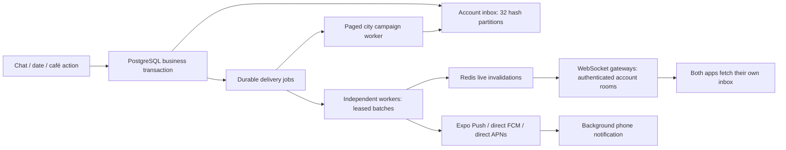

# Mello notifications: implementation and deployment

This module adds account-scoped live notifications to the dating and partner apps. It is an implementation intended for horizontal deployment, not a certification of five million simultaneous users. The local Docker stack has one API instance, PostgreSQL and Redis. Five million concurrent connections require a separately provisioned and measured distributed deployment.

## What users see

The bell in the dating app and partner dashboard opens a persistent inbox with unread badges, read-all, earlier updates and category preferences. A new notification shows an in-app toast while the app is open. Tapping it opens the relevant chat, date-planning flow, café content or partner date requests. Other devices synchronize read state. Reconnecting or returning to the foreground recovers saved notifications. Published offers can refresh an open café catalogue without a manual refresh.

| Event | Recipients | Tap destination |
| --- | --- | --- |
| New like | Person liked | Liked you |
| Mutual match | Both people | Chat |
| Message | Other participant | Chat |
| Date invitation | Invited person | Date plans for that match |
| Accepted / declined invitation | Other participant | Date plans |
| Date cancellation | Other participant; café admins if previously accepted | Date plans / partner requests |
| Both people accept a date | Café admins | Partner requests |
| Café confirms / declines | Both people | Date plans |
| Package or upcoming event first published | Active, onboarded dating users in that café's city who allow offers | Café menu and experiences |

Support employees do not receive admin reservation notifications. A package/event requires both published content and a published active venue. Drafts generate no campaign; publishing the venue later announces eligible content. Editing or republishing the same content does not spam another announcement. Campaign batches recheck publication and audience eligibility before creating notifications. These announcements are for future publications, not a backfill of historic listings.

## Delivery architecture



- Business writes, inbox rows and delivery jobs commit together. Rollbacks cannot leave a phantom notification. A unique `(account_id,event_key)` prevents repeated sends/retries from duplicating inbox entries.
- Workers claim with `FOR UPDATE SKIP LOCKED`, a 60-second lease and a lease ID used to fence updates from old workers. Independent LIVE, PUSH and CAMPAIGN loops isolate channels. Message/date jobs have priority 1; promotional jobs have priority 10. A worker restart recovers expired leases. Provider failures back off with jitter and enter `DEAD` after 12 failures. Rate-limit deferrals preserve the failure budget.
- Café publication writes a campaign job in the request transaction. The worker fans out in batches of 250, with a durable account cursor and audience cutoff. It does not load a city's entire audience or hold a request open while notifying everyone. Recipient insertion and corresponding job creation use one batched SQL statement.
- A notification namespace `/notifications` checks an active account/session at connection, assigns its room on the server, and disconnects when its access token expires. No client chooses recipients or rooms. Redis only carries account IDs and an invalidation; notification text stays behind the authenticated API. Every inbox fetch rechecks session revocation and ownership. An idle revoked socket may receive an empty invalidation until expiry, but cannot retrieve notification content.
- Gateways emit to local rooms, avoiding cross-cluster socket enumeration. Redis Pub/Sub is a fast signal, not the source of truth. Reconnect/foreground sync and a jittered 60–90 second recovery sync restore state if a signal is lost. Ordinary live delivery needs no page refresh. The normal worker polling period is 200 ms, followed by a 120 ms client debounce and network/API time; this is a configured behavior, not a measured end-to-end latency guarantee.
- Inbox pages use `(created_at,id)` cursors, account indexes and an unread partial index. Inbox read-state invalidations update the account's other devices.
- Push jobs recheck the enabled device, active owning account/session, unread state, age under 24 hours and preferences immediately before delivery. Push text is deliberately generic; names, message text and date details are fetched only after authentication. Logout revokes the session, preventing subsequent queued push sends on it. A provider request already in flight cannot be recalled.
- Expo sends are batched by project, distributed rate-limited through Redis, and checked for tickets plus later receipts. Invalid devices are disabled. Direct Android FCM uses cached OAuth credentials and the HTTP v1 API. Direct iOS APNs uses ES256 provider tokens and reusable HTTP/2 connections. Neither provider acceptance nor a receipt proves the phone displayed a notification. All transports are at-least-once; duplicates after ambiguous network failures remain possible. Clients use notification IDs and account ownership for recovery/deduplication.

## Local setup

The API runs the workers by default (`NOTIFICATION_WORKER_ENABLED=true`). Existing PostgreSQL and Redis are used. Apply migrations with `npm run db:migrate`, build with `npm run build` and start normally. Run `npm run db:validate:notifications` after migrating. Do not run local host DB commands against a different database than the app's Docker database.

For separate worker instances, set `NOTIFICATION_WORKER_ENABLED=false` on API replicas, and run `npm run start:notifications` on each worker after migrations finish. All replicas must share the same database and trusted Redis deployment. Worker replicas can run concurrently. The Docker `workers` profile provides a separate worker service; disable the embedded API worker before using that profile.

Phone push is disabled by default until real credentials exist. In-app notifications need no FCM/APNs credentials and work in Expo Go and browsers. Browser Web Push is not implemented; browser users receive live updates while the app is open.

## Enable background phone push

1. Link each app to its own EAS project and build a development or standalone app. Set backend `NOTIFICATION_USER_PROJECT_ID` and `NOTIFICATION_PARTNER_PROJECT_ID` to those respective EAS UUIDs. Device registration rejects a mismatched project or account type.
2. Configure Android Firebase push credentials and each app's Firebase client configuration. `GOOGLE_SERVICES_FILE` is an optional build-time path read by each app's dynamic config. Configure the iOS push entitlement and signing/APNs credentials for the corresponding bundle ID.
3. Choose transport before building:
   - `EXPO_PUBLIC_PUSH_TRANSPORT=expo` (default): configure push credentials with EAS; optionally set backend `EXPO_ACCESS_TOKEN` when enhanced push security is enabled. The worker batches up to 50 and defaults to 400 requests-to-devices/sec/project to leave headroom under Expo's documented 600/sec/project limit.
   - `EXPO_PUBLIC_PUSH_TRANSPORT=native`: Android registers its FCM device token, iOS its APNs token. Mount backend `FCM_USER_SERVICE_ACCOUNT_FILE` and `FCM_PARTNER_SERVICE_ACCOUNT_FILE` as secret files; do not commit private keys. For iOS set `APNS_KEY_FILE`, `APNS_KEY_ID`, `APNS_TEAM_ID`, `APNS_USER_TOPIC` and `APNS_PARTNER_TOPIC`. Set `APNS_SANDBOX=true` only for the sandbox environment appropriate to that build. Set `NATIVE_PUSH_RATE_LIMIT` to the approved provider/project throughput. Obtain provider quota increases before raising it.
4. Set backend `NOTIFICATION_PUSH_ENABLED=true` and restart workers. Rebuild/reinstall apps after changing native configuration or `EXPO_PUBLIC_PUSH_TRANSPORT`.
5. On the phone open **bell → Preferences → Enable phone notifications**, then grant permission. Later launches re-register an already-authorized device/session without prompting; token changes also re-register. Turning off a category or phone push takes effect in subsequent delivery checks.

Android remote push is unavailable in Expo Go; use an installed build. Foreground WebSocket notifications remain available there. Keep provider credentials in the backend/secret manager, never `EXPO_PUBLIC_*` variables. Real phone delivery remains an external credential/device verification step.

## Production capacity and five-million-user target

Five million registered accounts, five million open sockets, and five million simultaneous sends are different workloads. This implementation does not make one server handle all three. The following work is required before claiming that target:

1. Separate WebSocket gateways, REST APIs and workers. Put WebSocket-capable regional load balancers in front of gateways, support connection draining and spread reconnects. Benchmark real per-pod connection memory/CPU/file descriptors and network throughput. With measured safe capacity `C`, size for at least `ceil(5,000,000 / (0.65 × C))` gateway pods, plus multi-zone failure headroom. This is a sizing formula, not a measured pod count.
2. Use managed HA Redis on private networking with TLS/ACLs. The current notification invalidation channel is shared by all gateways. At high event rates, shard gateway groups and invalidation channels by account hash/region and route connections consistently to avoid broadcasting every invalidation to every node. This routing/sharding is an infrastructure/next-scale implementation requirement, not implemented automatically by the single local stack.
3. Provision HA PostgreSQL, connection pooling, tested IOPS and maintenance. The inbox has 32 hash partitions on one logical database; those partitions are not independent database shards. Add account-hash database sharding when measured writes/reads exceed the cluster budget. The outbox and campaign audience query also need measured capacity and indexes at the real data distribution.
4. Keep transactional notification latency separate from campaign completion time. Scale workers against queue age and provider throughput, not only CPU. Rate-limit/space campaigns and monitor oldest transactional job. Expo's default project cap cannot support millions of simultaneous phone pushes; direct FCM/APNs still require their own approved quotas and capacity tests.
5. Review the existing chat transport's cross-node `fetchSockets` delivery checks and per-socket periodic DB revalidation before a five-million-chat-socket rollout. Notification invalidations avoid that fan-out, but adding this module does not certify the rest of the app for that concurrency.
6. Run soak tests and fault injection: worker crashes before/after send, DB failover, Redis outage, expired tokens, revoked sessions, push 429/5xx, invalid tokens, fan-out backlog and reconnect storms. Verify no cross-account delivery. Choose and measure SLOs (for example foreground p95 under one second under the specified load), and allocate capacity from those measurements. This is a proposed target, not an achieved benchmark.

## Validation and load harness

`npm test` covers chat/date event integration, inbox isolation, cursors, read state, rollback, deduplication, category preferences, live WebSocket signals, retries, fencing, city campaigns, rate-limit deferral, dead-letter state, Expo tickets/receipts, and mocked direct FCM/APNs authentication and payloads. No real SMS or device push is sent by tests.

`npm run test:load:notifications -- --confirm-staging` connects disposable staging-account tokens from `NOTIFICATION_LOAD_TOKENS_FILE` to `NOTIFICATION_LOAD_URL`. Configure `NOTIFICATION_LOAD_CLIENTS`, `NOTIFICATION_LOAD_SECONDS` and `NOTIFICATION_LOAD_RAMP_PER_SECOND`. The input file is JSON `[{"token":"<staging access token>"}]`; keep it outside version control. The harness consumes notifications while a separate staging producer exercises chat/date/offer actions. It records connection errors, synchronization latency and age of newly created notifications without logging tokens. Synchronize clocks between producer/server/load agents.

Run distributed load agents with disjoint account/token files to reach the target; a single local run is not a five-million-user test. The harness intentionally does not create users, send SMS or create production notifications. A full UI/phone test still needs real app builds and configured credentials.

## Operations

Monitor these by channel and priority, alongside DB query latency, Redis errors, gateway connections, provider 429/5xx, receipt failures and mobile delivery metrics:

```sql
SELECT channel, priority, state, count(*), min(created_at) AS oldest
FROM notification_jobs GROUP BY channel, priority, state;
SELECT count(*) FROM notification_jobs WHERE state='DEAD';
SELECT status,count(*) FROM notification_push_receipts GROUP BY status;
```

Alert on growing transactional queue age and dead-letter counts. Investigate a dead job before replaying its ID; retrying with the same notification ID keeps the inbox idempotent. Add scheduled, bounded cleanup/archival for old DONE jobs, checked receipts, obsolete device registrations and inbox retention according to the product policy. Cleanup is deliberately not run against existing user data automatically. Keep the event-key deduplication horizon long enough for producer retries. Do not unbounded-delete millions of rows in one transaction.

## API

All routes below require the account's active bearer session:

| Method | Path | Purpose |
| --- | --- | --- |
| GET | `/api/notifications` | Own inbox, unread count, cursor `{at,id}` |
| GET | `/api/notifications/:id` | Own notification, including push-tap recovery |
| POST | `/api/notifications/read` | `{ids:[...]}` or read-all `{before:ISO8601}` |
| GET / PUT | `/api/notifications/preferences` | messages, dates, matches, likes, offers, push booleans |
| POST | `/api/notifications/devices` | app, provider, token, projectId, platform |
| DELETE | `/api/notifications/devices/:id` | Disable own device |

## Provider documentation

- [Expo notifications for SDK 58](https://docs.expo.dev/versions/v58.0.0/sdk/notifications/)
- [Expo push delivery, limits and receipts](https://docs.expo.dev/push-notifications/sending-notifications/)
- [FCM HTTP v1 authentication and delivery](https://firebase.google.com/docs/cloud-messaging/send/v1-api)
- [APNs token-based connections](https://developer.apple.com/documentation/usernotifications/establishing-a-token-based-connection-to-apns)

The local smoke check is `node scripts/smoke-notifications.cjs` inside the running development backend. It creates and deletes its own temporary accounts/sessions and verifies PostgreSQL → outbox → Redis → WebSocket → authenticated inbox for both account types. It does not send device pushes. After smoke testing, `notifications` and `notification_jobs` contained no test records. This small functional check is not a capacity benchmark.
